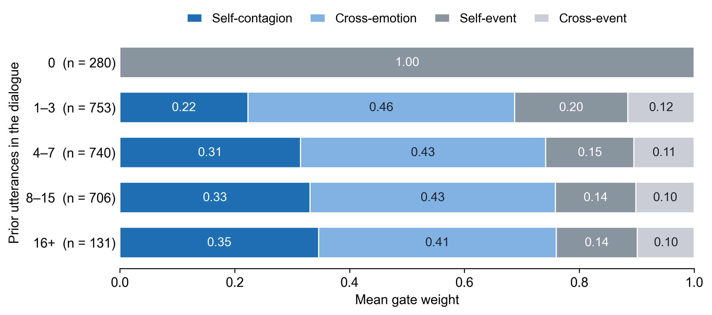
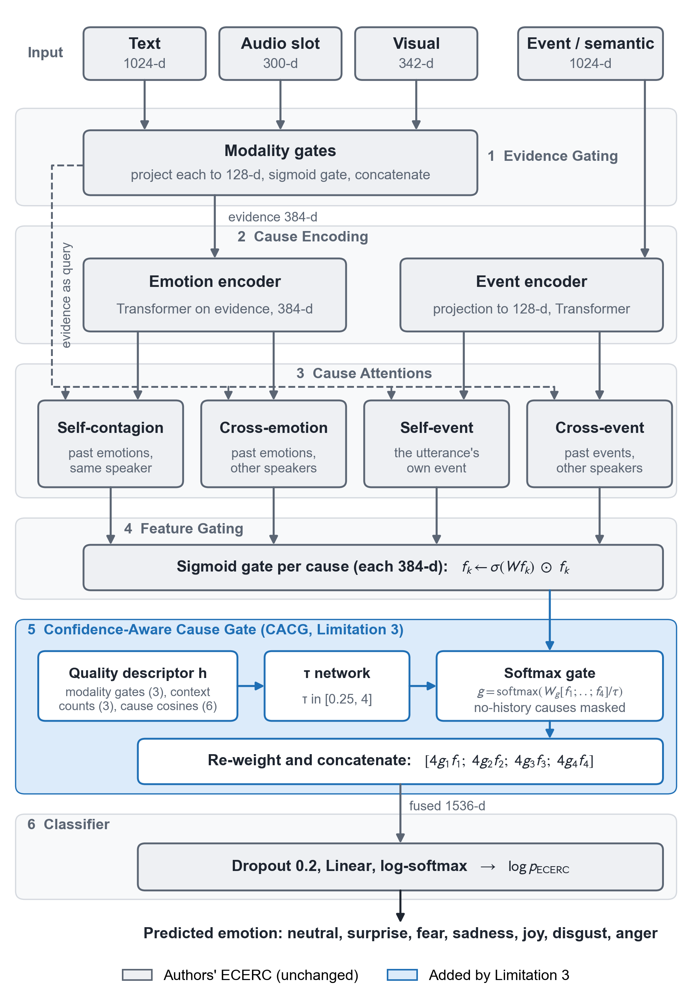

# ECERC Revisited: Final MELD Results

Keshav Mishra · October 30, 2026

## Summary

The final merged system (ECERC + Limitation 3's gate + Limitation 2's LLM fusion) reaches 53.77 macro-F1 on the MELD test set, against 50.87 for the authors' checkpoints. That gain is +2.90, 95% CI [+0.42, +5.29]. Accuracy rises from 67.32 to 68.17 and weighted F1 from 66.46 to 67.11, but those two intervals include zero.

- **Limitation 2 (class imbalance):** 12 methods failed to give a confirmed gain before zero-shot LLM fusion worked. Fusion adds 3 to 4 macro-F1 points, led by Fear and Disgust, and costs 2 to 3 points of Joy F1.
- **Limitation 3 (confidence-aware gating):** no accuracy gain beyond seed noise on MELD. It adds interpretability, showing which cause drove each prediction.
- **Combined:** nearly all of the score gain comes from the LLM.

## Setup

Macro-F1 is the main metric, because it gives every emotion equal weight and exposes the class imbalance. MELD has seven emotions, and Fear and Disgust together make up less than 6% of every split.

| Split | Dialogues | Utterances | Fear | Disgust |
| --- | --- | --- | --- | --- |
| Train | 1038 | 9989 | 268 | 271 |
| Dev | 114 | 1109 | 40 | 22 |
| Test | 280 | 2610 | 50 | 68 |

- **Metrics:** accuracy, weighted F1 (wF1), macro-F1 (mF1), per-emotion F1 and expected calibration error (ECE, lower is better).
- **Selection rule:** every setting was chosen on dev. Test was used only for final scoring.
- **Authors' checkpoints:** the mean of the three released models. It matches the paper exactly, at 67.32 accuracy and 66.46 wF1.
- **Retrained baseline:** ECERC with the authors' recipe, retrained in the merged code on seeds 0, 1 and 2.
- **Confidence intervals:** 95% dialogue-level bootstrap on test.

## Limitation 2: methods tried before LLM fusion

None of the 12 methods below gave a confirmed macro-F1 gain. Together they showed that the limit is ECERC's evidence, not its decision rule, loss or training budget. Each "likely reason" is our interpretation of the results, not a proven cause.

### 1. Loss and sampling changes (4 methods)

**Why we tried these.** They are the standard response to class imbalance, and they need no change to the model. Each was trained on three seeds with the authors' recipe otherwise unchanged.

- **Class-balanced loss (CB0.999):** per-class weights based on the effective number of samples, inside the authors' focal loss. Fear gets weight 3.06 and Neutral 0.73.
- **Stronger focal loss (FL2):** focal exponent raised from 1 to 2, so training concentrates on harder utterances.
- **Oversampling (OS2):** the 315 dialogues containing Fear or Disgust are drawn twice as often. Each class's share of training utterances rises from about 2.7% to about 3.9%.
- **Combination (FL2-OS2):** both of the last two changes together.

| Configuration | Acc | wF1 | mF1 | Fear F1 | Disgust F1 |
| --- | --- | --- | --- | --- | --- |
| Baseline (this study) | 66.87 | 66.00 | **50.40** | 26.22 | 30.72 |
| CB0.999 | 64.88 | 65.36 | 49.52 | 22.37 | 29.69 |
| FL2 | 66.76 | 65.87 | 50.06 | 25.49 | 30.16 |
| OS2 | 66.60 | 65.78 | 50.02 | 25.51 | 30.94 |
| FL2-OS2 | 66.26 | 65.37 | 49.13 | 22.46 | 30.31 |

Every variant had lower test macro-F1 than the baseline on all three seeds.

**Likely reasons for failure:**

- **CB0.999:** Fear recall rose from 22.7 to 36.7, but false positives rose from 25 to 95 per run. The extra Fear predictions were correct only 9% of the time, and F1 needed at least 13%.
- **FL2:** the authors' loss is already focal, so this is a small change. Fear recall did not move.
- **OS2:** it repeats the same few rare examples and adds no new evidence. Disgust recall rose, but precision fell.
- **FL2-OS2:** it combined both effects and gave the lowest macro-F1 of the five.

These methods change how often the model predicts rare classes, not how well it can separate them.

### 2. Post-hoc logit adjustment (1 method)

**Why we tried this.** It tests whether the authors' checkpoints already hold minority signal that a shifted decision rule could use. The prediction becomes argmax(log p − τ · log train prior), with τ chosen on dev and no retraining.

**Result.** Macro-F1 changed by −0.24, 95% CI [−1.06, +0.68], at τ = 0.1. The +1.0 target was excluded.

**Likely reason for failure.** The adjustment moved mostly correct predictions. 19 extra Fear predictions gave 1 correct one, and 70 of 129 utterances moved away from Neutral really were Neutral. So this is not a threshold problem.

The errors are also systematic: 30 of 31 dev Fear utterances misclassified by any checkpoint are misclassified by all three. A separate leak check found only a small train-side advantage in the text features (gap +7.6, below the rule of 15), so we ruled out a label leak.

### 3. Training-time representation changes (4 methods)

**Why we tried these.** After ruling out the decision rule, we tested whether ECERC's learned representation was the limit. A candidate needed +0.5 dev macro-F1 to reach the test set.

| Method | Purpose | Dev mF1 | vs original |
| --- | --- | --- | --- |
| Original recipe | Control | 54.12 | 0.00 |
| Mean of 4 RoBERTa layers | Richer text features | 54.05 | −0.07 |
| Confusion-aware contrastive loss | Pull confused emotions apart | 53.91 (best weight) | −0.22 |
| Auxiliary sentiment head | Extra training signal | 54.31 (best weight) | +0.19 |
| Learning rate 3e-5 | Test for under-training | 54.06 | −0.06 |

**Result.** No candidate passed the gate, so the test set was not used.

**Likely reason for failure.** Fear and Disgust stayed at about 30 to 36 dev F1 under every candidate. The higher learning rate reached the same peak about 20 epochs earlier and then overfit, so under-training is not the cause. Emotions that overlap in ECERC's input features stay hard to separate, whatever the loss.

### 4. Fusion with a model trained on MELD (2 methods)

**Why we tried these.** ECERC only sees precomputed features, so we added a second model that reads the raw dialogue text. Its scores were combined with ECERC's using a weight chosen on dev.

- **RoBERTa-large text expert:** fine-tuned on the dialogue text with past context only. Macro-F1 changed by +0.27, 95% CI [−1.92, +2.29], which is inconclusive. Fear F1 rose by 3.40, but Disgust fell by 1.97 and Joy by 2.61.
- **Qwen2.5-7B LLM expert:** fine-tuned with QLoRA for one epoch. The cross-fitted dev gain was −0.98 against a +0.5 gate, so the test set was not used.

**Likely reason for failure.** Both models learned from MELD's skewed labels, so they share ECERC's imbalance. The 7B LLM reached only 22 to 23 dev Disgust F1, against 36 to 43 for ECERC. Fusion therefore traded one emotion for another.

### 5. Better audio evidence (1 method)

**Why we tried this.** Audio is ECERC's weakest input: a linear probe on the openSMILE features scores 22.5 dev macro-F1. We replaced them with frozen Whisper-large-v3 features, which score 28.7, and corrected the audio/visual routing. ECERC itself stayed unchanged.

**Result.** The best arm gained +0.08 dev macro-F1 against a +0.5 gate, so the test set was not used.

**Likely reason for failure.** Text evidence dominates on MELD. The better audio raised dev Sadness F1 by 2.2 but lowered Joy by 2.4, so it shifted the boundary between related emotions instead of separating them.

## Final approach: zero-shot LLM fusion

We chose a zero-shot LLM because it is the only partner that was never trained on MELD's skewed labels. The earlier experts failed by sharing ECERC's imbalance, so we needed a model with different errors.

**Why we decided on this approach:**

- **The failure pattern pointed to it.** Every second source of evidence trained on MELD traded one emotion for another.
- **Published results suggested the right error profile.** Zero-shot LLaMA-70B reports Fear 33.3, Disgust 39.8 and Sadness 47.3 F1, against ECERC's 26.1, 31.4 and 41.0.
- **A small pilot supported it.** A local 3B model on dev went from a −0.91 gain to +0.76 after calibration.

**How it works:**

1. Qwen2.5-32B-Instruct (4-bit, frozen) scores every utterance, using only the dialogue so far. It is never trained on MELD.
2. A label-free calibration divides out the LLM's mean dev prediction and multiplies in the training class prior.
3. The calibrated scores are combined with ECERC's after training, using one weight w chosen on dev.

```math
\log p_{\mathrm{final}} = (1 - w)\,\log p_{\mathrm{ECERC}} + w\,\log \tilde{p}_{\mathrm{LLM}}, \qquad w = 0.2
```

The cross-fitted dev gain was +5.63 against a +0.5 gate, so the method went to the test set once.

**Why it worked where the others failed.** Alone, the LLM matches ECERC on macro-F1 (51.05 against 50.87) with the opposite errors. It is stronger on Disgust (37.58 against 31.43) and weaker on Joy (55.57 against 64.95).

We also tried to distill the LLM into ECERC so that no LLM is needed at inference. It failed, with a cross-fitted dev gain of −0.42 against a +1.0 gate.

## Results: baseline vs LLM fusion

LLM fusion raised test macro-F1 by 3.38 on the authors' checkpoints and by 4.02 on the retrained baseline. Fear, Sadness and Disgust gained the most, and Joy fell.

| System | Accuracy | Weighted F1 | Macro-F1 |
| --- | --- | --- | --- |
| Authors' checkpoints | 67.32 ± 0.25 | 66.46 ± 0.12 | 50.87 ± 0.43 |
| Authors' checkpoints + LLM | 68.24 ± 0.10 | 67.26 ± 0.04 | **54.25 ± 0.09** |
| Retrained baseline | 66.83 ± 0.46 | 65.72 ± 0.38 | 49.57 ± 0.54 |
| Retrained baseline + LLM | 68.11 ± 0.04 | 67.01 ± 0.04 | **53.59 ± 0.06** |

Values are mean ± std over three checkpoints or seeds. The macro-F1 gains are +3.38, 95% CI [+0.64, +5.73], and +4.02, 95% CI [+1.55, +6.45]. The first interval re-selects w in every resample, and the second keeps w fixed.

| Emotion F1 | Authors | Authors + LLM | Change | Retrained | Retrained + LLM | Change |
| --- | --- | --- | --- | --- | --- | --- |
| Neutral | 79.79 | 79.58 | −0.21 | 79.55 | 79.60 | +0.05 |
| Surprise | 58.97 | 62.20 | +3.23 | 57.81 | 61.10 | +3.29 |
| Fear | 26.12 | 33.77 | **+7.64** | 23.21 | 32.31 | **+9.10** |
| Sadness | 40.95 | 46.69 | **+5.74** | 38.87 | 46.38 | **+7.51** |
| Joy | 64.95 | 61.67 | −3.28 | 64.18 | 61.62 | −2.56 |
| Disgust | 31.43 | 40.22 | **+8.79** | 30.46 | 38.85 | **+8.39** |
| Anger | 53.89 | 55.61 | +1.72 | 52.91 | 55.29 | +2.38 |

The pre-registered verdict on the authors' checkpoints is a trade-off, not a clean success. The Joy loss of 3.28 broke the −2.0 guardrail set before the run.

## Limitation 3 results

CACG did not change MELD accuracy beyond seed noise. Its value is lower calibration error with dynamic τ and a readable view of which cause the model used.

| Variant | Accuracy | Weighted F1 | Macro-F1 | ECE raw | ECE after scaling |
| --- | --- | --- | --- | --- | --- |
| Baseline retrained (3 seeds) | 66.65 ± 0.34 | 65.39 ± 0.34 | 48.96 ± 0.29 | 9.48 | 3.01 |
| **CACG, dynamic τ** | **66.67 ± 0.05** | **65.34 ± 0.16** | **48.63 ± 0.52** | **9.12** | **2.42** |
| CACG + utility gate loss | 66.69 ± 0.11 | 65.59 ± 0.04 | 49.33 ± 0.49 | 8.67 | 3.18 |
| CACG + SOP entropy loss | 66.59 ± 0.25 | 65.20 ± 0.18 | 47.22 ± 0.96 | 8.19 | 2.54 |

These runs used plain cross-entropy on MELD, not the authors' focal loss, so this baseline sits below the other tables. With the authors' loss in the merged code, CACG with dynamic τ gives 67.09 / 65.96 / 49.67, against 66.83 / 65.72 / 49.57 for the baseline. ECE after scaling is 3.05 against 3.49.

### Interpretability

The gate gives each utterance a weight for each of the four causes, so we can read which cause the model relied on. The figure and findings below come from the merged model on the MELD test set, averaged over three seeds.



- **Emotion causes dominate.** Among the 1731 utterances with all four causes available, the weights are 0.34 self-contagion, 0.42 cross-emotion, 0.14 self-event and 0.10 cross-event.
- **Cross-emotion leads.** It receives the largest weight on 80% of test utterances.
- **Self-contagion grows with history.** Its weight rises from 0.22 with 1 to 3 prior utterances to 0.35 with 16 or more.
- **The first utterance has one cause.** With no history, all of the weight goes to the utterance's own event.
- **Rare emotions differ slightly.** Fear leans more on self-contagion (0.31 against a mean of 0.26), and Disgust on cross-emotion (0.44 against 0.39).

Two limits apply. The weights are nearly the same for correct and wrong predictions, so they show what the model used, not whether it is right. τ also stayed almost constant at about 0.97, so it did not vary with the input in this variant.

## Final comparison: merged system vs authors' checkpoints

The final merged system (Limitation 2 + Limitation 3) beats the authors' checkpoints by 2.90 macro-F1 on test. Its accuracy and weighted F1 are also higher, but those two intervals include zero.

| Metric | Authors' checkpoints | Final merged system | Change | 95% CI of change |
| --- | --- | --- | --- | --- |
| Accuracy | 67.32 ± 0.25 | 68.17 ± 0.06 | +0.85 | [−0.69, +2.38] |
| Weighted F1 | 66.46 ± 0.12 | 67.11 ± 0.07 | +0.65 | [−0.94, +2.21] |
| **Macro-F1** | **50.87 ± 0.43** | **53.77 ± 0.07** | **+2.90** | **[+0.42, +5.29]** |

The authors' column is the mean of their three released checkpoints. The merged column is `cacg_none + LLM`, retrained on three seeds.

| Emotion F1 | Authors' checkpoints | Final merged system | Change |
| --- | --- | --- | --- |
| Neutral | 79.79 | 79.62 | −0.17 |
| Surprise | 58.97 | 61.22 | +2.25 |
| Fear | 26.12 | 32.88 | **+6.76** |
| Sadness | 40.95 | 46.14 | **+5.19** |
| Joy | 64.95 | 62.05 | −2.90 |
| Disgust | 31.43 | 39.06 | **+7.63** |
| Anger | 53.89 | 55.42 | +1.53 |

- **Calibration:** ECE after temperature scaling is 3.18, against 3.02 for the authors' checkpoints. Raw ECE is 15.14 against 5.02, because the fused scores are over-confident, so fused systems should be reported after scaling.
- **Authors' checkpoints + LLM:** this reaches 54.25, which is 0.48 above the merged system, 95% CI [−1.02, +0.01]. CACG therefore adds no score gain over direct fusion.

## Final ECERC architecture with Limitation 3

Stage 5 is the only change inside the network, and it adds 6,621 parameters to ECERC's 5,810,187 (+0.11%). With the gate removed, the code gives the same outputs as the authors' model (maximum difference 0.00 on a random-input test).



Grey blocks are the authors' ECERC, unchanged, and the blue block is added by Limitation 3. LLM fusion is not shown because it runs after training, outside the network.

## Limitations of these results

The gain is real but modest in certainty, because the same test set has now been used four times. After correcting for four looks, the 98.75% interval on the +2.90 gain is [−0.30, +5.96], which includes zero.

- **Selection:** dev ranks `baseline + LLM` first (59.96 against 59.51 for the merged system). We name `cacg_none + LLM` as the merged system because it combines both limitations.
- **Not selected:** `cb0.999 + LLM` scored 54.45 on test but ranked third on dev, so it is not our headline.
- **Baseline gap:** the retrained baseline here is 0.83 macro-F1 below our earlier retraining (50.40). The cause is not established, so we quote the fusion gain as about 3 to 4 points.
- **Small classes:** test has only 50 Fear and 68 Disgust utterances, so per-emotion changes are noisy. The Fear change on the authors' checkpoints has a 95% CI of [−3.10, +18.14].
- **Uncertainty:** the small ± values on fused rows understate it, because the LLM scores come from one fixed run. Use the confidence intervals.
- **Cost:** the full system needs a 32B LLM at inference, and it has not been tested on IEMOCAP.
- **LLM data:** the LLM's pretraining may include Friends transcripts or MELD's public files. Alone, it is below ECERC on weighted F1 (63.14 against 66.46).
